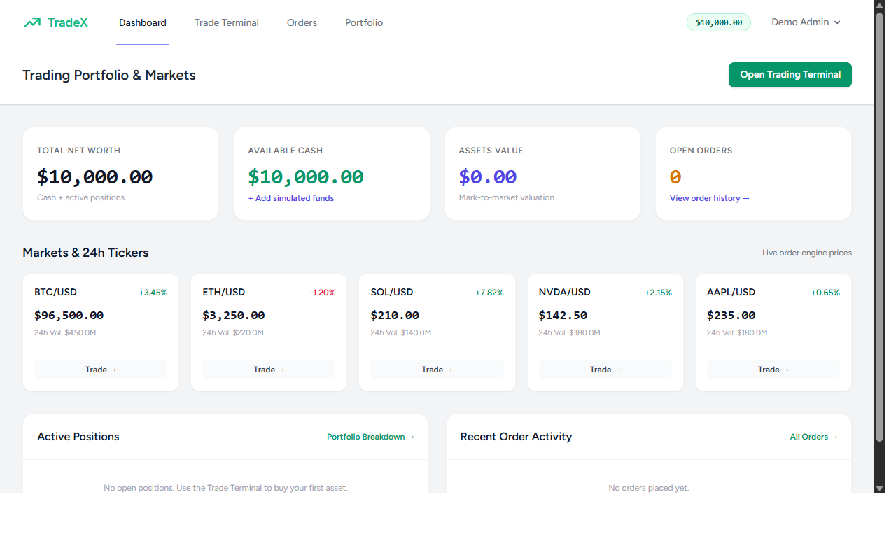

# ERP System (Laravel)

Modular Enterprise Resource Planning system built with Laravel 11/13, Blade, Tailwind CSS, and transactional integrity across inventory, purchasing, sales, finance, and human resources.

[]()
[]()

---

## 1. Project Overview

The **ERP System** provides enterprises with end-to-end operational traceability:
- **Inventory & Warehouses**: Product SKUs, real-time stock balances, min-threshold alerts, and logged stock movements.
- **Purchasing**: Supplier directories, Purchase Orders (PO), and transactional Goods Receipt updating on-hand stock.
- **Sales**: Customer directory, Sales Orders (SO), pre-fulfillment inventory checks, and automatic stock deduction.
- **Finance**: Chart of accounts, multi-type ledger transactions (income/expense), and dynamic balance calculation.
- **Human Resources (HR)**: Department hierarchy, job positions, employee records, and salary administration.
- **Audit Logs**: Immutable system-wide trail recording operational events (module, action, user, timestamp).

---

## 2. Key Modules & Workflows

1. **Purchasing & Goods Receipt**:
   - Issue Purchase Order &rarr; mark goods received &rarr; atomic DB transaction increments product stock and logs incoming movement.
2. **Sales & Order Fulfillment**:
   - Create Sales Order &rarr; verify item availability &rarr; fulfill order &rarr; atomic DB transaction deducts inventory and logs dispatch.
3. **Financial Accounting**:
   - Chart of accounts (Assets, Liabilities, Equity, Revenue, Expense) tracked in minor integer units (cents) preventing floating-point discrepancies.
4. **Audit Trail**:
   - Every stock adjustment, PO generation, goods receipt, SO fulfillment, and financial entry writes an auditable event.

---

## 3. Technology Stack

- **Backend**: Laravel 11/13, Eloquent ORM, DB Transactions
- **Auth**: Laravel Breeze
- **Database**: SQLite (default local) / PostgreSQL compatible
- **Frontend**: Blade + Tailwind CSS + Vite
- **Testing**: PHPUnit / Pest (31 automated tests, 92 assertions)

---

## 4. Quickstart

```bash
# Clone repository
git clone https://github.com/0xyz-exe/erp-system-laravel.git
cd erp-system-laravel

# Setup environment & dependencies
cp .env.example .env
composer install
php artisan key:generate

# Run migrations & seeders
touch database/database.sqlite
php artisan migrate

# Build frontend assets
npm install
npm run build

# Start dev server
php artisan serve
```

---

## 5. Verification

```bash
# Run test suite
php artisan test

# Validate Composer
composer validate

# Audit production npm packages
npm audit --omit=dev
```

---

## 6. License

MIT License. Developed as part of the Laravel Projects Factory.


## Screenshots

### Dashboard Overview

